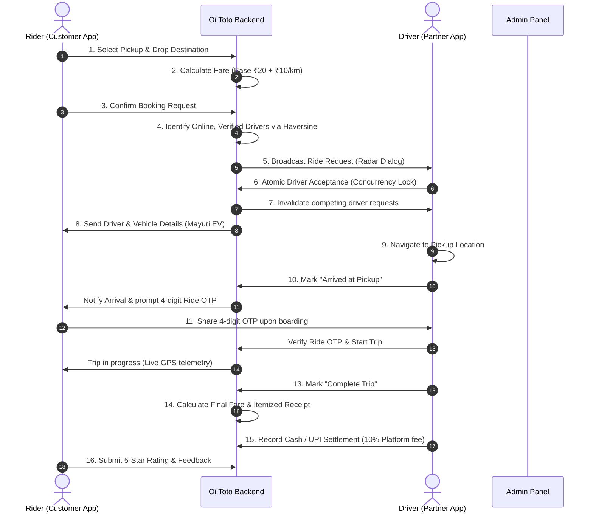

# 🛺 Oi Toto! — Pan-India E-Rickshaw Booking Platform

> **"Oi Toto! — Tap. Book. Cholo!"**
> A modern, scalable, production-oriented Electric Rickshaw (E-Rickshaw) ride-hailing and fleet management platform engineered specifically for Indian cities, towns, and metro feeder corridors.

---

## ⚡ 1. Brand Identity & Overview

| Attribute | Specification |
| :--- | :--- |
| **Official Brand Name** | **Oi Toto!** |
| **Android Display Name** | **Oi Toto! — E-Rickshaw Booking** |
| **Driver Display Name** | **Oi Toto! Partner — Driver App** |
| **Tagline** | *"Tap. Book. Cholo!"* |
| **Vehicle Category** | **Electric Rickshaw (E-Rickshaw / Toto / Battery Auto)** |
| **Brand Colors** | Eco-Green (`#0A8B42`), Warm Yellow (`#FFB703`), Deep Forest Navy (`#0B3C35`), Crisp White (`#FFFFFF`) |
| **Official Logo** | E-Rickshaw with electric lightning bolt, speedometer arc, and location pin |
| **Language Support** | **English**, **Bengali (বাংলা)**, and **Hindi (हिन्दी)** |

---

## 🏗️ 2. Technology Stack & Architecture

- **Backend:** PHP 8.2+ with Modular REST API engine, PSR-4 autoloading, PDO prepared statements, JWT authentication, and transactional state machines.
- **Database:** MySQL 8.0+ / MariaDB with 23 relational tables, foreign key constraints, indexes, and full spatial Haversine distance functions.
- **Customer Mobile App:** Flutter & Dart (Clean Architecture, trilingual localization, live GPS tracking, 4-digit Ride OTP, SOS emergency response).
- **Driver Mobile App:** Flutter & Dart (Atomic acceptance lock, KYC document uploads, online/offline availability switch, live radar, earnings ledger).
- **Admin Panel:** HTML5, CSS3, Bootstrap 5, Leaflet.js live fleet radar, and responsive dashboard.
- **FinTech & Payments:** Cash collection reconciliation with double-entry driver ledger, and Razorpay / UPI sandbox & live integration.

---

## 📂 3. Project Directory Structure

```text
G:\oitoto\
├── admin\                         # Web-based Admin Panel Dashboard
│   ├── assets\
│   │   ├── css\
│   │   ├── js\
│   │   └── img\logo.png          # Official Oi Toto Brand Logo
│   └── index.html                 # Complete responsive Admin Dashboard
├── apps\
│   ├── customer_app\              # Customer Android Application (Flutter)
│   │   ├── android\app\src\main\  # AndroidManifest.xml & Gradle
│   │   ├── assets\images\logo.png # App icon and splash logo
│   │   ├── lib\
│   │   │   ├── core\constants\    # API endpoints & map defaults
│   │   │   ├── core\localization\ # English, Bengali, Hindi dictionaries
│   │   │   ├── core\services\     # ApiService HTTP client
│   │   │   ├── core\theme\        # Oi Toto Green/Yellow theme
│   │   │   ├── screens\           # Splash, Onboarding, Auth, Home, ActiveRide, Receipt, History, Profile
│   │   │   └── main.dart          # Customer App entry point
│   │   └── pubspec.yaml
│   └── driver_app\                # Driver Partner & Owner App (Flutter)
│       ├── android\app\src\main\  # AndroidManifest.xml & Permissions
│       ├── assets\images\logo.png
│       ├── lib\
│       │   ├── core\constants\
│       │   ├── core\localization\ # English, Bengali, Hindi driver texts
│       │   ├── core\services\     # DriverApiService client
│       │   ├── core\theme\        # High-contrast driver theme
│       │   ├── screens\           # Splash, Auth, Home, KYC, Earnings, Profile
│       │   └── main.dart          # Driver App entry point
│       └── pubspec.yaml
├── assets\
│   └── branding\
│       ├── oi_toto_logo.png       # Reference high-res brand artwork
│       └── oi_toto_logo.jpg
├── backend\                       # PHP 8.2+ Modular REST API
│   ├── config\
│   ├── migrations\
│   │   └── 001_initial_schema.sql # 23 relational database tables
│   ├── public\
│   │   ├── index.php              # Front controller and REST router
│   │   └── uploads\               # KYC documents and vehicle photos
│   ├── seeds\
│   │   └── 001_seed_data.sql      # Seed areas, fares, vehicles, admin
│   ├── src\
│   │   ├── Controllers\           # Auth, Customer, Driver, Vehicle, Booking, Fare, Payment, Admin, Review, Support
│   │   ├── Core\                  # Database (PDO), Router, Request, Response, Auth (JWT), Validator, Logger
│   │   ├── Middleware\            # Cors, AuthMiddleware, RoleMiddleware, RateLimit
│   │   └── Services\              # OtpService, FareCalculatorService, MatchingService, LocationService, PaymentService
│   ├── tests\
│   │   └── test_api.php           # Automated 14-point test suite
│   ├── .env                       # Live environment config
│   ├── .env.example
│   └── composer.json
└── docs\                          # Comprehensive platform documentation
    ├── API_DOCUMENTATION.md       # Complete REST API reference
    ├── ARCHITECTURE.md            # System architecture and lifecycle
    ├── DATABASE_SCHEMA.md         # Database tables, keys, and ERD
    ├── DEPLOYMENT_GUIDE.md        # Production server and MySQL guide
    ├── TESTING_CHECKLIST.md       # Quality assurance checklist
    └── ANDROID_BUILD_INSTRUCTIONS.md # Android APK/AAB build steps
```

---

## 🚀 4. Quick Start & Setup Guide

### Prerequisites
1. **PHP 8.2+** with extensions `pdo_mysql`, `mbstring`, `openssl`, `curl`, `json`.
2. **MySQL 8.0+** or MariaDB (e.g., via XAMPP or native service).
3. **Flutter 3.x+** & Android SDK (for compiling the APKs).

### 1. Database Setup
The database migration and seed data can be executed directly using the MySQL CLI:
```bash
mysql -u root -e "source G:/oitoto/backend/migrations/001_initial_schema.sql"
mysql -u root -e "source G:/oitoto/backend/seeds/001_seed_data.sql"
```

### 2. Start the PHP REST API Server
```bash
cd G:\oitoto\backend
C:\php82\php.exe -S 0.0.0.0:8000 -t public
```

### 3. Run Backend Verification Test Suite
```bash
C:\php82\php.exe G:\oitoto\backend\tests\test_api.php
```
*Expected result: 14/14 automated tests pass.*

### 4. Access the Web Admin Panel
Open your browser and navigate to:
```text
http://localhost:8000/../../admin/index.html
```
Or serve `G:\oitoto\admin` with any static server or XAMPP htdocs.
- **Default Super Admin Login:** `9876543210`
- **Password:** `Admin@OiToto2026`

---

## 🛺 5. Complete 16-Step E-Rickshaw Booking Lifecycle



---

## 🔒 6. Safety, Compliance & Concurrency Safeguards

1. **Atomic Concurrency Locking:** Guaranteed prevention of double-acceptance using MySQL row-level transactions (`SELECT ... FOR UPDATE` + atomic conditional `UPDATE bookings SET driver_id = ? WHERE id = ? AND driver_id IS NULL`).
2. **Ride Start Verification OTP:** Drivers cannot initiate trips without entering the customer's secret 4-digit start OTP shown only on the customer's screen.
3. **Emergency SOS Helpline:** Instant integration with National Emergency Helpline `112` and automated SMS/push alerts to registered family contacts with live GPS coordinates.
4. **Regulatory KYC Compliance:** Pre-approval gate prevents unverified drivers from going online without verified Driving Licences, commercial permits, and E-Rickshaw fitness certificates.
5. **Driver FinTech Ledger:** Double-entry ledger records cash collected in hand and debits the 10% platform commission from the digital wallet, with zero discrepancies.

---

## 📄 Documentation Links

- [Complete API Documentation](docs/API_DOCUMENTATION.md)
- [System Architecture](docs/ARCHITECTURE.md)
- [Database Schema & ERD](docs/DATABASE_SCHEMA.md)
- [Deployment & Backup Guide](docs/DEPLOYMENT_GUIDE.md)
- [Testing Checklist](docs/TESTING_CHECKLIST.md)
- [Android Build Instructions](docs/ANDROID_BUILD_INSTRUCTIONS.md)
