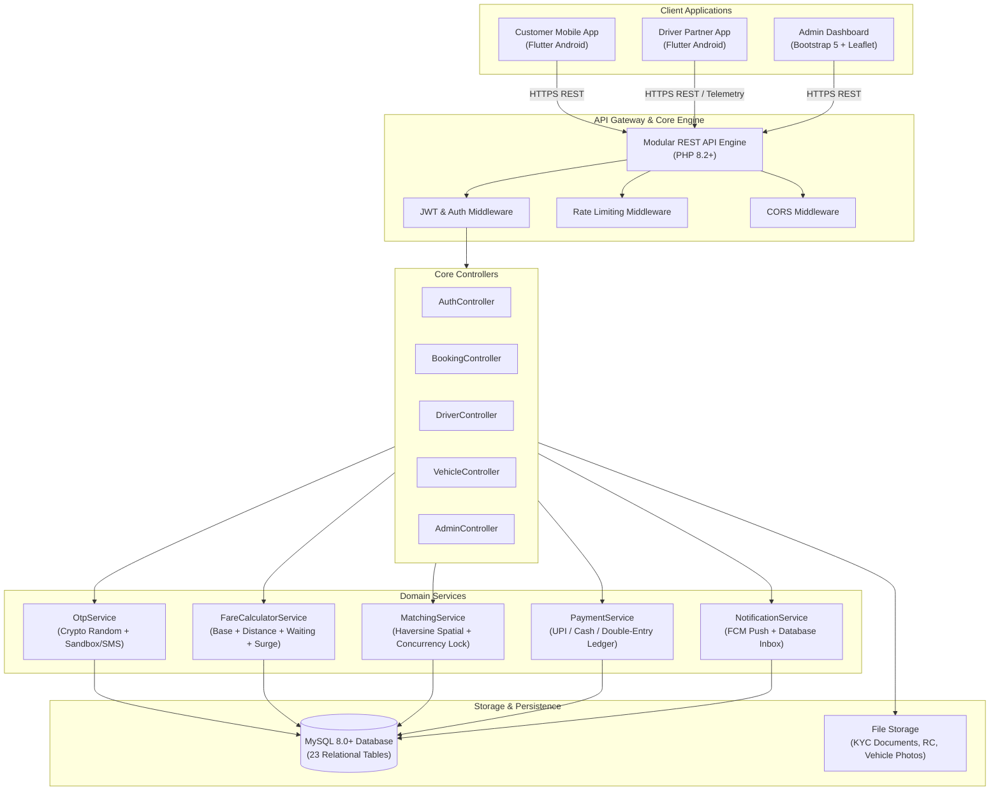

# 🏗️ Oi Toto! — Architectural Specification

## 1. System Overview

**Oi Toto!** is an on-demand micro-mobility platform tailored for the unique dynamics of India's Electric Rickshaw (E-Rickshaw / Toto) ecosystem. Unlike traditional cab-hailing apps, E-Rickshaws operate primarily on:
1. **Short-range feeder corridors** (1 to 5 km) connecting metro stations, railway terminals, suburban markets, and residential colonies.
2. **Low average cruising speeds** (15 to 22 km/h) designed for high energy efficiency and passenger safety.
3. **Dual Fleet Ownership Models:**
   - **Company-Owned / Fleet Operator Vehicles:** Owned by Oi Toto or commercial fleet aggregators and assigned to verified salaried or lease drivers.
   - **Independent Driver-Owned Vehicles:** Owned by individual driver-partners (Owner-Operators) who retain 90% of trip fares.

---

## 2. Multi-Tier Architecture Diagram



---

## 3. Atomic Driver Concurrency Locking

In high-density feeder stations (such as Sealdah Station or Shyambazar Metro), multiple drivers may simultaneously tap "Accept" on the same broadcast ride request.

To guarantee that **never under any circumstances will two drivers accept the same ride**, the matching engine executes:
```sql
START TRANSACTION;

-- 1. Pessimistic row-level lock on booking
SELECT * FROM bookings WHERE id = :booking_id FOR UPDATE;

-- 2. Verify state is still 'requested' or 'dispatched' and driver_id is NULL
-- If another driver already committed, this returns 0 affected rows:
UPDATE bookings 
SET driver_id = :driver_id, 
    vehicle_id = :vehicle_id, 
    booking_status = 'accepted', 
    accepted_at = NOW() 
WHERE id = :booking_id 
  AND driver_id IS NULL 
  AND booking_status IN ('requested', 'dispatched');

-- 3. If rowCount() == 1, mark current driver as busy:
UPDATE driver_profiles SET is_busy = 1 WHERE id = :driver_id;

COMMIT;
```
If `rowCount() === 0`, an immediate rollback is executed and the rejected driver receives a clean error message: *"Booking was already accepted by another driver"*.

---

## 4. E-Rickshaw Fare Engine Logic

Fares are configured individually per geographic service zone.
The default formula is:

$$\text{Final Fare} = \max\left(\text{Minimum Fare}, (\text{Base Fare} + \text{Extra Distance Fare} + \text{Waiting Fare}) \times \text{Night Surge}\right) - \text{Discount}$$

Where:
- $\text{Base Distance} = 1.50\text{ km}$ (charged at Base Fare of ₹20)
- $\text{Extra Distance Fare} = \max(0, \text{Distance} - 1.50) \times ₹10/\text{km}$
- $\text{Waiting Fare} = \max(0, \text{Waiting Mins} - 3\text{ free mins}) \times ₹1.00/\text{min}$
- $\text{Night Surge Multiplier} = 1.25\times$ (applicable between 22:00:00 and 05:00:00)
- $\text{Platform Commission} = 10\%$
- $\text{Driver Net Share} = 90\%$

---

## 5. FinTech & Double-Entry Ledger Mechanics

When rides are completed with cash, the driver receives 100% of the fare directly in hand from the passenger.
To settle the 10% platform fee transparently without cash collection agents:
1. The driver maintains a digital prepaid/postpaid wallet balance in `driver_wallets`.
2. When cash is marked collected, the 10% platform fee is automatically deducted from `current_balance`, and recorded in `ledger_entries` under `platform_commission_debit`.
3. When rides are paid digitally via UPI / QR code, the driver's net 90% share is directly credited to `current_balance` under `trip_earning`.
4. Drivers can request payout transfers directly to their registered UPI ID or Bank account whenever the balance exceeds ₹100.
