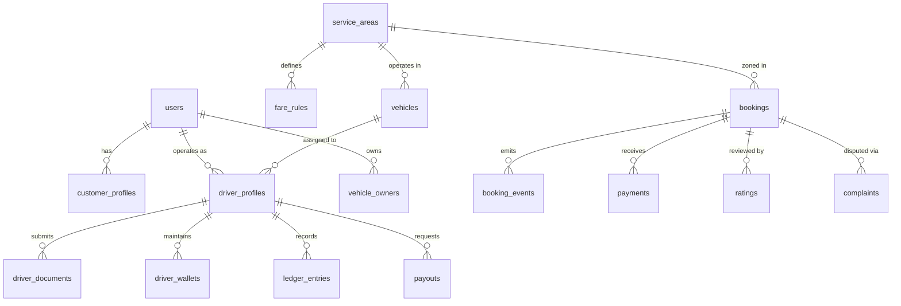

# 🗄️ Oi Toto! — Database Schema Reference

**Database Name:** `oitoto_db`  
**Engine:** InnoDB  
**Charset:** `utf8mb4`  
**Collation:** `utf8mb4_unicode_ci` (Full multilingual English, Hindi, and Bengali script support)

---

## 1. Entity-Relationship Overview

---

## 2. Table Catalog

### 1. `users`
Central user registry for riders, drivers, fleet owners, and system administrators.
- `id` (BIGINT UNSIGNED, PK, AUTO_INCREMENT)
- `phone` (VARCHAR(15), UNIQUE, NOT NULL) — 10-digit Indian mobile format
- `full_name` (VARCHAR(120), NOT NULL)
- `email` (VARCHAR(150), NULL)
- `role` (ENUM: `'customer'`, `'driver'`, `'owner'`, `'admin'`, `'super_admin'`)
- `status` (ENUM: `'active'`, `'pending'`, `'suspended'`, `'deactivated'`)
- `language` (VARCHAR(10), DEFAULT `'en'`) — `'en'`, `'bn'`, `'hi'`
- `fcm_token` (VARCHAR(255), NULL) — Push notification device token
- `otp_code` (VARCHAR(10), NULL) — 6-digit hashed/plain verification token
- `otp_expires_at` (DATETIME, NULL) — 5-minute expiry window
- `otp_attempts` (INT, DEFAULT 0) — Locks after 5 failed attempts
- `password_hash` (VARCHAR(255), NULL) — Bcrypt hash for admin logins

### 2. `customer_profiles`
Customer ride records, emergency safety contact, and saved locations.
- `id` (BIGINT UNSIGNED, PK, AUTO_INCREMENT)
- `user_id` (BIGINT UNSIGNED, FK -> `users.id`, UNIQUE)
- `emergency_contact_name` (VARCHAR(120), NULL)
- `emergency_contact_phone` (VARCHAR(15), NULL)
- `home_address`, `home_lat`, `home_lng` (VARCHAR, DECIMAL(10,8), DECIMAL(11,8))
- `work_address`, `work_lat`, `work_lng` (VARCHAR, DECIMAL(10,8), DECIMAL(11,8))
- `rating_avg` (DECIMAL(3,2), DEFAULT 5.00)
- `total_rides` (INT, DEFAULT 0)

### 3. `driver_profiles`
Operational status, assigned vehicle, KYC verification, and live telemetry coordinates.
- `id` (BIGINT UNSIGNED, PK, AUTO_INCREMENT)
- `user_id` (BIGINT UNSIGNED, FK -> `users.id`, UNIQUE)
- `vehicle_id` (BIGINT UNSIGNED, FK -> `vehicles.id`, NULL)
- `service_area_id` (BIGINT UNSIGNED, FK -> `service_areas.id`, NULL)
- `ownership_model` (ENUM: `'company_driver'`, `'owner_operator'`, `'fleet_driver'`)
- `driving_license_no` (VARCHAR(50), NULL)
- `dl_expiry` (DATE, NULL)
- `aadhaar_number` (VARCHAR(20), NULL)
- `pan_number` (VARCHAR(20), NULL)
- `bank_account_no`, `bank_ifsc`, `bank_beneficiary_name`
- `current_lat`, `current_lng` (DECIMAL(10,8), DECIMAL(11,8)) — Real-time GPS coordinates
- `heading` (DECIMAL(5,2), DEFAULT 0.00)
- `is_online` (TINYINT(1), DEFAULT 0) — Availability switch
- `is_busy` (TINYINT(1), DEFAULT 0) — Trip concurrency lock
- `status` (ENUM: `'pending_review'`, `'verified_active'`, `'rejected'`, `'suspended'`)
- `rating_avg` (DECIMAL(3,2), DEFAULT 5.00)
- `total_trips` (INT, DEFAULT 0)

### 4. `vehicles`
Electric rickshaw inventory and regulatory fitness/insurance tracking.
- `id` (BIGINT UNSIGNED, PK, AUTO_INCREMENT)
- `owner_id` (BIGINT UNSIGNED, FK -> `vehicle_owners.id`, NULL)
- `vehicle_number` (VARCHAR(30), UNIQUE, NOT NULL) — e.g., `WB-01-E-1001`
- `registration_certificate_no` (VARCHAR(50), NULL)
- `vehicle_type` (ENUM: `'e_rickshaw'`, `'e_loader'`, `'e_cart'`)
- `brand_make` (VARCHAR(100), DEFAULT `'Mayuri EV'`)
- `battery_type` (ENUM: `'lithium_ion'`, `'lead_acid'`)
- `ownership_type` (ENUM: `'company_owned'`, `'driver_owned'`, `'fleet_owned'`)
- `seating_capacity` (INT, DEFAULT 4)
- `status` (ENUM: `'pending_verification'`, `'approved'`, `'rejected'`, `'maintenance'`, `'inactive'`)
- `fitness_expiry`, `insurance_expiry`, `permit_expiry` (DATE)

### 5. `fare_rules`
Zonal pricing formulas for electric rickshaws.
- `id` (BIGINT UNSIGNED, PK, AUTO_INCREMENT)
- `service_area_id` (BIGINT UNSIGNED, FK -> `service_areas.id`)
- `base_fare` (DECIMAL(8,2), DEFAULT 20.00) — Covers up to `base_distance_km`
- `base_distance_km` (DECIMAL(5,2), DEFAULT 1.50)
- `per_km_rate` (DECIMAL(8,2), DEFAULT 10.00)
- `minimum_fare` (DECIMAL(8,2), DEFAULT 20.00)
- `per_minute_waiting_charge` (DECIMAL(8,2), DEFAULT 1.00)
- `free_waiting_minutes` (INT, DEFAULT 3)
- `night_surge_multiplier` (DECIMAL(4,2), DEFAULT 1.25)
- `night_surge_start` / `end` (TIME: `'22:00:00'` to `'05:00:00'`)
- `platform_commission_percentage` (DECIMAL(5,2), DEFAULT 10.00)

### 6. `bookings`
Core trip state machine and financial calculation record.
- `id` (BIGINT UNSIGNED, PK, AUTO_INCREMENT)
- `booking_code` (VARCHAR(30), UNIQUE, NOT NULL) — e.g. `OT-20261015-8910`
- `customer_id` (BIGINT UNSIGNED, FK -> `users.id`)
- `driver_id` (BIGINT UNSIGNED, FK -> `driver_profiles.id`, NULL)
- `vehicle_id` (BIGINT UNSIGNED, FK -> `vehicles.id`, NULL)
- `pickup_address`, `pickup_lat`, `pickup_lng`
- `drop_address`, `drop_lat`, `drop_lng`
- `estimated_distance_km`, `estimated_duration_mins`, `estimated_fare`
- `actual_distance_km`, `actual_duration_mins`, `waiting_duration_mins`
- `final_fare`, `base_fare_charged`, `distance_fare_charged`, `waiting_fare_charged`
- `platform_commission_amount`, `driver_earnings_amount`
- `payment_mode` (ENUM: `'cash'`, `'upi'`, `'wallet'`, `'online'`)
- `payment_status` (ENUM: `'pending'`, `'paid'`, `'failed'`, `'refunded'`)
- `booking_status` (ENUM: `'requested'`, `'dispatched'`, `'accepted'`, `'arrived'`, `'in_progress'`, `'completed'`, `'cancelled'`, `'expired'`)
- `start_otp` (VARCHAR(6), NOT NULL) — 4-digit ride verification code
- Timestamps: `requested_at`, `accepted_at`, `arrived_at`, `started_at`, `completed_at`, `cancelled_at`

### 7. `driver_wallets` & `ledger_entries`
FinTech double-entry accounting ledger.
- `driver_wallets`: `driver_id`, `current_balance`, `total_earned`, `total_withdrawn`, `pending_settlement`, `cash_collected_held`
- `ledger_entries`: `driver_id`, `booking_id`, `entry_type` (`trip_earning`, `platform_commission_debit`, `cash_collected_deduction`, `payout_credit`), `amount`, `balance_after`, `description`
